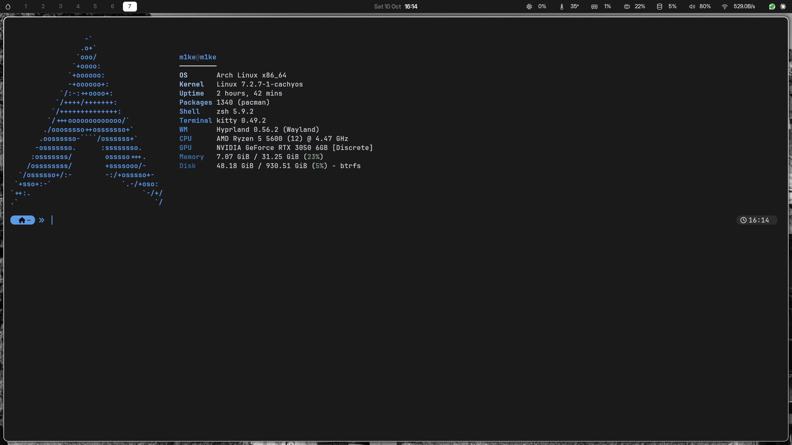
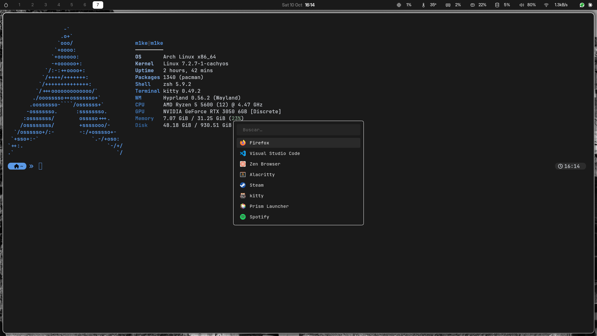

<div align="center">

# 🖤 dotfiles

**Un escritorio Hyprland oscuro, limpio y rápido — instalable con un solo comando.**




<sub>Waybar con iconos SVG propios · kitty + fastfetch · prompt starship de una línea con pastillas</sub>

<br><br>



<sub>Rofi con iconos, buscador y la misma paleta del escritorio</sub>

</div>

---

## ✨ Qué incluye

| | |
|---|---|
| 🪟 **Hyprland** | Configuración en **Lua** (`hyprland.lua`): atajos, animaciones, reglas de monitor y ventanas. `hyprland.conf` queda de respaldo. |
| 📊 **Waybar** | Métricas reales de CPU, temperatura, GPU, RAM, disco y red, con iconos SVG propios; batería y brillo para portátiles. |
| 🔍 **Rofi** | Lanzador, selector de ventanas, portapapeles, emojis, wifi, bluetooth y menú de apagado. |
| 🖥️ **kitty + zsh + starship** | Prompt de una línea con pastillas, autosugerencias, resaltado de sintaxis, `zoxide`, `fzf` y `fastfetch`. |
| 🔔 **mako, hyprlock, hypridle** | Notificaciones, pantalla de bloqueo con tu fondo y suspensión automática. |
| 🎨 **Tema GNOME oscuro** | `adw-gtk3-dark`, iconos Adwaita, cursor Bibata y fuentes Inter + JetBrainsMono Nerd. |
| 🔊 **PipeWire de baja latencia** | Configuración lista en `config/pipewire`. |
| 🌐 **Zen Browser afinado** | `user.js` con tema oscuro, decodificación por GPU y ajustes de red y caché. |
| ⚡ **Rendimiento (opcional)** | BBR, wifi sin ahorro de energía, CPU en `performance` y planificador `scx_lavd`. |
| 🖼️ **Fondos de pantalla** | Tres fondos incluidos en `wallpapers/`. |

---

## 🚀 Instalación

```sh
git clone https://github.com/macorredor270/dotfiles ~/dotfiles
~/dotfiles/install.sh
```

Y ya está. El instalador actualiza el sistema, instala lo que falta, enlaza las configuraciones, activa los servicios y aplica el tema.
Para ver qué haría **sin cambiar nada** (ni pedir `sudo`):

```sh
~/dotfiles/install.sh --simular
```

### Tres formas de usarlo

| Comando | Para qué sirve |
|---|---|
| `./install.sh` | **Todo**: paquetes, drivers según tu GPU, enlaces, servicios, tema y ajustes de rendimiento. |
| `./install.sh --visual` | **Replicar solo el aspecto** en un portátil u otro equipo Arch: 38 paquetes, sin `-Syu`, sin drivers, sin tocar `/etc`. |
| `./install.sh --solo-config` | **No instala nada**: solo enlaza las configuraciones y aplica el tema. Vale en cualquier distro. |

> En un equipo recién instalado, ejecuta antes `sudo pacman -Syu` si usas `--visual`, para no tener la base de datos de paquetes vieja.

Más opciones: `--solo FASE` (`paquetes`, `enlaces`, `zen`, `shell`, `servicios`, `tema`, `sistema`, `verificar`), `--sin-actualizar`, `--sin-paquetes`,
`--sin-aur`, `--sin-enlaces`, `--sin-sistema`, `--sin-rendimiento` y `--opcionales` (Steam, Prism, Node, Rust, Podman…).

---

## ⌨️ Atajos (`Super` = tecla Windows)

<table>
<tr><td valign="top">

**Aplicaciones**

| Atajo | Acción |
|---|---|
| `Super + Enter` · `Ctrl + Alt + T` | Terminal (kitty) |
| `Super + E` | Archivos (Nautilus) |
| `Super + D` · `Alt + Espacio` | Lanzador de apps |
| `Super + Tab` | Selector de ventanas |
| `Super + R` | Ejecutar comando |
| `Super + Shift + V` | Historial del portapapeles |
| `Super + .` | Selector de emojis |
| `Super + W` | Wifi |
| `Super + B` | Bluetooth |
| `Super + Esc` | Menú de apagado |
| `Super + L` | Bloquear pantalla |

</td><td valign="top">

**Ventanas y escritorios**

| Atajo | Acción |
|---|---|
| `Super + Q` | Cerrar ventana |
| `Super + F` | Pantalla completa |
| `Super + V` | Flotante / mosaico |
| `Super + P` · `Super + J` | Pseudo-mosaico · cambiar división |
| `Super + ← ↑ ↓ →` | Mover el foco |
| `Super + Shift + ← ↑ ↓ →` | Mover la ventana |
| `Super + 1…0` | Ir al escritorio 1–10 |
| `Super + Shift + 1…0` | Enviar ventana al escritorio |
| `Super + rueda` | Escritorio siguiente / anterior |
| `Super + clic izq / der` | Arrastrar / redimensionar |
| `Super + Shift + E` | Salir de Hyprland |

</td></tr>
</table>

**Capturas y sonido** — `Ctrl + Alt + S` o `Super + S`: región · `Ctrl + Alt + K`: pantalla completa (se guardan en `~/Pictures/Screenshots` y se copian al portapapeles, sin editor) ·
`Ctrl + Alt + ↑ / ↓`: volumen · teclas multimedia y de brillo.

---

## 🧠 Cómo funciona el instalador

`install.sh` está pensado para repetirse sin romper nada: si algo ya está bien, lo deja como está.

| Fase | Qué hace |
|---|---|
| **Paquetes** | `pacman -Syu` y solo instala lo que falta de `packages/*.txt`. Si un paquete no existe, lo salta y avisa; si falla en bloque, prueba uno a uno. Compila `paru` si no está. |
| **Hardware** | Detecta CPU y GPU por identificador PCI y añade el microcódigo y los drivers que toquen (`nvidia-open-dkms` o `nvidia-dkms` con las cabeceras de **cada** kernel, o Mesa/Vulkan para AMD e Intel). |
| **Enlaces** | Enlaza con symlinks cada archivo de `config/` en `~/.config`, más `.zshrc`, `.bashrc`, `local-bin/` y los `.desktop`. Lo que ya existía se guarda en `~/.dotfiles-backup-FECHA/`. |
| **Zen / Shell / Servicios** | `user.js` en el perfil de Zen, zsh como shell y los servicios de red, Bluetooth, SDDM, PipeWire y aria2. |
| **Tema** | `gsettings`: modo oscuro, `adw-gtk3-dark`, iconos Adwaita, cursor Bibata y fuentes. |
| **Sistema** | Ajustes de `/etc`, cada uno **solo si aplica** a tu equipo (módulo del kernel, wifi, cpufreq, sched_ext). |
| **Verificación** | Programas, fuentes, enlaces, sintaxis de `.zshrc`, `Hyprland --verify-config` y configuración de Rofi. |

Todo queda registrado en `~/.dotfiles-install.log`.

### 🔧 Se adapta al equipo donde lo instalas

- **GPU** — las variables de NVIDIA de `hyprland.lua` solo se aplican si el driver propietario está cargado. En AMD o Intel no se tocan: con ellas, la pantalla se quedaría en negro. El módulo de GPU de Waybar lee NVIDIA y AMD, y muestra `n/a` si no hay ninguna.
- **Pantalla** — la regla de 1080p a 75 Hz solo afecta al monitor `HDMI-A-1`; cualquier otra usa su resolución preferida con escala automática (portátiles HiDPI).
- **Portátil** — la barra incluye batería y brillo. En un PC de sobremesa, Waybar los oculta solo.
- **Temperatura de la CPU** — si `hwmon1` no es la CPU, el instalador busca `k10temp`, `coretemp` o `zenpower` y ajusta la ruta.
- **Rutas** — si tu usuario no es `m1ke`, los archivos con rutas escritas a mano se copian ya corregidos; el resto sigue enlazado al repo, así que un `git pull` actualiza atajos y estilo sin reinstalar.

---

## 🗂️ Estructura

```text
dotfiles/
├── install.sh          instalador inteligente
├── config/             → ~/.config   (hypr, waybar, rofi, kitty, mako, fastfetch, gtk-3.0/4.0, pipewire, systemd/user…)
├── local-bin/          → ~/.local/bin   (screenshot, rofi-wifi, rofi-bluetooth, rofi-clipboard, rofi-power, zen-fast…)
├── local-share/        → ~/.local/share/applications   (lanzadores)
├── packages/           listas de paquetes: pacman, aur, visual (modo ligero) y opcional
├── system/             → /etc   (sysctl, NetworkManager, systemd, modprobe) — solo con sudo y solo si aplica
├── templates/          archivos con la ruta de tu $HOME (aria2.conf)
├── zen/                user.js de Zen Browser
├── wallpapers/         fondos de pantalla
├── docs/               capturas de este README
├── .zshrc  .bashrc
```

---

## ↩️ Deshacer

- **Configuraciones:** todo lo que se reemplazó está en `~/.dotfiles-backup-FECHA/`.
- **Rendimiento:** `sudo systemctl disable --now max-performance scx-sched` y borra `/etc/sysctl.d/99-rendimiento.conf`.

## 📝 Notas

- Hyprland carga `hyprland.lua` si existe; edita siempre ese archivo y deja el `.conf` como respaldo.
- NVIDIA: tras la primera instalación, reinicia para que DKMS compile el módulo y repite `./install.sh --solo paquetes`.
- No incluye secretos (claves SSH, tokens) ni servicios de proyectos personales.

<div align="center"><sub>Hecho con 🖤 para <b>CachyOS</b> · Hyprland · Wayland</sub></div>
